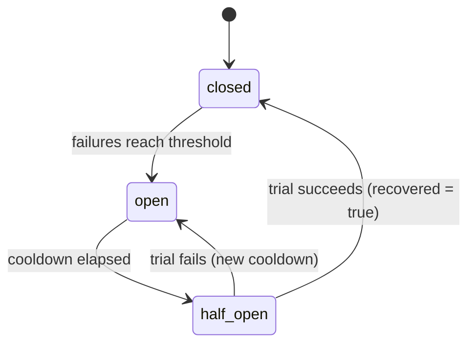
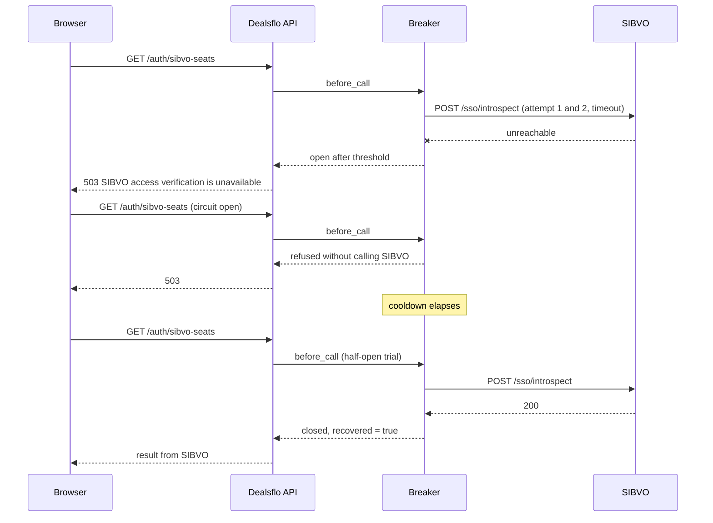

# SIBVO and Dealsflo entitlement, seat and usage contract

- **Epic:** DFR1-E12, SIBVO Identity, Entitlement, Seat & Billing Integration
- **Stories:** DFR1-004, DFR1-005, DFR1-053 (partial, see section 10)
- **Authority:** ADR-0027 (Proposed). This document records the contract as implemented on the E12 branches.
- **Related:** `docs/architecture/sibvo-dealsflo-sso-contract.md`
- **Repositories:**
  - SIBVO: `backend/app/modules/identity/sso_router.py` (endpoints), `backend/app/modules/entitlements/seat_service.py` (seat rules), `backend/app/modules/billing/upgrade_requests.py` (plan changes), `backend/scripts/seed_e12_integration.py` (test seed).
  - Dealsflo: `backend/app/integrations/sibvo_client.py` (the only SIBVO client), `backend/app/team/member_removal.py` (team removal), `backend/app/billing/entitlements.py`, `backend/app/auth/dependencies.py`, `backend/app/api/auth.py`, `backend/app/api/team.py`.

## 1. Ownership

SIBVO owns identity, organizations, memberships, product membership, plans,
subscriptions, trials, entitlements, seats and billing.

Dealsflo owns its CRM records, its product roles and permissions, its own team
membership rows, and its product usage events. Dealsflo never keeps a seat
counter, never grants subscription access, and never computes SIBVO seat
entitlements.

## 2. Service-to-service endpoints

All calls are `POST` form requests to SIBVO under `/api/v1/sso`, authenticated with
Dealsflo's confidential client credentials (HTTP Basic). The client ID and secret
are configured in SIBVO (`SSO_DEALSFLO_CLIENT_ID`, `SSO_DEALSFLO_CLIENT_SECRET`)
and in Dealsflo (`SSO_DEALSFLO_CLIENT_ID`, `SSO_DEALSFLO_CLIENT_SECRET`).

| Endpoint | Purpose | Retry | Result on denial |
|---|---|---|---|
| `/sso/introspect` | Access snapshot for a session | safe (read) | `{"active": false}` |
| `/sso/seat-usage` | Seat capacity for the Dealsflo product (owners) | safe (read) | `{"active": false}` |
| `/sso/product-seats/release` | Revoke a removed member's Dealsflo product membership and release the seat | safe (idempotent state change, `idempotency_key`) | 403 or 409 with `{"error_code": ...}` |

A read denial never says which check failed. Client authentication failure returns 401 on
every endpoint. Dealsflo's health check uses SIBVO's public `GET /api/v1/ready`.

### 2.1 Access snapshot

When access is granted, SIBVO returns `active: true` with `organization_id`,
`product_key`, `subscription_status`, `plan_version_id`, `product_role` and `entitlements`
(`feature_key`, `enabled`, `limit_value`, `limit_unit`).

Dealsflo validates every revalidation. The snapshot's organization must equal the
session's SIBVO organization, and its product must equal `sso_dealsflo_product_key`.
A missing or mismatched binding, or a malformed response, fails closed with 503, and
the stored snapshot is not replaced. `active: false` revokes the Dealsflo session.
Feature checks for attested sessions require the session's organization to equal the
requested organization, then read only the stored snapshot.

Revalidation runs when the stored snapshot is older than `SSO_REVALIDATION_INTERVAL_SECONDS`
(default 30, range 5–300). That interval is the maximum staleness of a revocation.

### 2.2 Seat capacity

Returned when the caller is an active product owner with a valid subscription:
`seat_limit` (null when not seat-based), `allocated` (active product memberships),
`reserved` (pending, unexpired invitations for the product), `available`
(`seat_limit - allocated - reserved`, floored at 0, null when unlimited).

Dealsflo exposes it as `GET /api/v1/auth/sibvo-seats`. The endpoint requires an attested
session (404 otherwise), shows capacity to product owners only (403 otherwise), and calls
SIBVO only with identifiers bound to the session. It returns 403 when SIBVO denies, and
503 when SIBVO is unavailable or returns a malformed or mis-bound body.

### 2.3 Product seat release (removal)

Used only by Dealsflo's team removal (section 3). The request carries the acting
administrator's SIBVO subject, session and organization, the target member's subject, an
optional reason (max 500 characters) and an idempotency key. Dealsflo derives the key from
the membership ID (`team-removal-<membership id>`), so every retry of the same removal uses
the same key.

Result on success: `{"released": true, "already_released": false, "reason": "released"}`.
A repeat returns `already_released: true`. A member with no Dealsflo seat returns
`{"released": false, "reason": "not_held"}`.

Refusals: `403 actor_not_authorized` (the actor is not an active owner, the session is
invalid or expired, or the actor targets themself); `409 last_owner_or_owner_seat` (the
target holds an owner seat, which removal never releases).

**Boundary.** This endpoint changes only the Dealsflo product membership, by setting its
status to `suspended`. It never changes the organization membership or the global SIBVO
identity. It does not depend on the subscription status, so a lapsed plan can still remove
members. The audit event records the actor, organization, target product membership, reason
and idempotency key.

## 3. Team removal lifecycle (Dealsflo)

Endpoint: `POST /api/v1/team/members/{membership_id}/remove` with required body `{"reason": "..."}`.
The reason is trimmed and must be 1–500 characters after trimming. Anything else returns 422 before any SIBVO call or local change.
Requires `organization.members.manage`.

Sequence, chosen so a failure never reports success:

1. Lock the Dealsflo membership and apply the removal rules: an administrator cannot remove
   themself, owners cannot be removed (the last owner is refused, and owner memberships are
   refused).
2. If the member has a SIBVO identity link and the organization has a SIBVO link, call
   `/sso/product-seats/release` with the signed-in administrator's SIBVO identifiers. The
   administrator must be SIBVO-attested in the linked organization (403 otherwise).
   Nothing local changes until SIBVO answers.
3. Only after SIBVO confirms: deactivate the Dealsflo membership, revoke the member's
   sessions in this organization, write a `team_member_removals` row (actor, organization,
   membership, affected user, reason, seat outcome, timestamp), and write the authorization
   audit event `team.member.removed`. Then commit.

Responses:

| Condition | HTTP | Member state | Message |
|---|---|---|---|
| Removed; SIBVO released the seat | 200 | inactive | "Member removed. SIBVO confirmed the seat." |
| Removed; member not linked to SIBVO | 200 | inactive | `seat_outcome: not_linked` |
| Already removed; SIBVO confirms (retry) | 200 | inactive | `already_removed: true` |
| SIBVO unavailable, rejected or malformed | 503 | **still active** | "SIBVO did not confirm the removal…" |
| SIBVO refuses the actor | 403 | still active | "SIBVO did not authorize this removal." |
| Owner seat or last owner | 409 | still active | Server reason |

Retries are safe. A failed attempt changes nothing, so a retry starts clean. If the local
commit fails after SIBVO released the seat, a retry gets `already_released` from SIBVO and
completes the local removal.

Authorization after removal: the member's Dealsflo sessions are revoked immediately. Their
SIBVO product membership is suspended, so SIBVO's introspection returns `active: false` for
any remaining session, and the session is revoked at its next revalidation.

Frontend (`TeamAccessPage`): shows a pending notice while the request runs, a success
message that states what SIBVO confirmed, and a failure message that never says the member
was removed unless SIBVO confirmed it.

## 4. Seat lifecycle (SIBVO is the only seat authority)

Seats are counted by SIBVO's `count_seats`: allocated = active product memberships;
reserved = pending, unexpired invitations for the product. Every operation that changes seat
usage takes the subscription row lock (`SELECT ... FOR UPDATE`), so two requests cannot both
take the last seat.

| Lifecycle event | Seat effect | Where |
|---|---|---|
| Invitation created (product invitation) | **Reserves** a seat. Rejected when allocated + reserved ≥ limit | `reserve_invitation_seat` |
| Invitation accepted | **Allocates** the reserved seat. Rejected when allocated ≥ limit, excluding its own reservation. Idempotent for an active seat | `allocate_invitation_seat` |
| Membership activated by an owner (direct assignment) | **Allocates**. Rejected for duplicates and when full | `assign_product_member` |
| Dealsflo team removal | **Releases** the product seat (status `suspended`) after SIBVO confirms (section 3) | `release_seat_for_removed_member` |
| Product membership removed by an owner | **Releases** (status `suspended`). The last active owner cannot be removed | `release_product_seat` |
| Organization membership deactivated | **No SIBVO flow exists.** See gap 1 | Gap |
| Invitation expired or revoked | Stops counting as a reservation | `count_seats` |
| Plan activation (upgrade or downgrade) | **Checked**: allocated + reserved must fit the purchased seat count, capped by the target plan's `max_seats`. Rejected with `seat_capacity_insufficient` and the counts. The subscription row is locked first | `activate` |

### 4.1 Plan activation: capacity check

`activate` (upgrade or downgrade) counts allocated seats and pending reservations under the
subscription lock. Capacity is `request.seat_count`, reduced to the target plan's `max_seats`
when the plan is seat-based. If `allocated + reserved` exceeds that capacity, activation is
refused with HTTP 409 and the message "Seat usage (N) exceeds the seats available on this
plan (M)…". Expired, revoked and accepted invitations are not counted.

Concurrency is covered by a PostgreSQL test. A reservation holds the subscription lock, an
activation waits for it, and the activation then sees the reservation. Removing the
activation's lock makes that test fail, which was confirmed by a mutation check
(`backend/tests/test_seat_concurrency.py`).

### 4.2 Remaining seat gaps (blockers for complete seat enforcement)

1. **Organization membership deactivation has no SIBVO flow.** No code path sets
   `OrganizationMembership.status` to anything but `active`. Removal in Dealsflo covers the
   Dealsflo product membership only. An organization-level deactivation needs its own SIBVO
   decision, because it also affects the global identity boundary.
2. **Subscription downgrade is available only through plan activation** (section 4.1). There is
   no separate downgrade endpoint, and none is defined.

## 5. Local entitlement authority

Dealsflo's local `plan`, `subscription` and `plan_entitlement` tables decide access only for
unattested sessions, and only when `LOCAL_ENTITLEMENT_FALLBACK_ENABLED` is `true`.

| Environment | Flag | Behaviour |
|---|---|---|
| `development` | `false` (default) | Unattested feature access denied |
| `development` | `true` | Local tables decide. Explicit opt-in |
| `test` | `true` (set by the test configuration) | Legacy request-path tests use the local tables |
| `staging` | must be `false` | Startup refused if `true`. Unattested access denied |
| `production` | must be `false` | Startup refused if `true`. Unattested access denied |

Environment detection never enables the fallback. The flag is validated when settings load
(`app/config.py`, `validate_security`).

## 6. Feature limits: definitions, enforcement owner, and status

A limit is enforced only when all of the following are defined for the feature key. Until
then, the limit is not enforced and is not presented as enforced.

| Required definition | Meaning |
|---|---|
| Unit | Business meaning and unit, for example "records", "automation runs" |
| Counting rule | What is counted, which Dealsflo operation consumes the limit, and when a use is counted |
| Reset period | Calendar month, subscription period, or none (cumulative) |
| Enforcement owner | The system that enforces it: Dealsflo at the consuming operation, with SIBVO as the source of the limit value |
| Concurrency rule | How concurrent requests are serialized before the count is checked |

Current state, by feature key in the SIBVO catalogue:

| Feature key | Type | Limit | Unit | Counting rule | Reset | Owner | Status |
|---|---|---|---|---|---|---|---|
| `workflow_automation` | Boolean | none | none | none | none | Dealsflo (`require_entitlement`) | Enforced as a boolean (on/off). No numeric limit exists |

**Result.** No numeric limit is enforced. The billing page shows any SIBVO limit as
"SIBVO limit N unit; not enforced in Dealsflo". Enforcing a limit requires a feature
owner to define the five items above. Inventing units or counting rules for an unlimited
feature would be creating limit semantics that the business has not agreed.

What SIBVO enforces today: none of the `limit_value` fields. They are stored on
`plan_version_entitlements`, validated as non-negative, and returned in the snapshot. Limit
changes and revocations reach Dealsflo at the next revalidation (within the revalidation
interval).

## 7. Usage reporting (DFR1-053 dependency)

**Blocked.** SIBVO has no usage-ingestion endpoint, and Dealsflo has no usage client or
ledger. Usage reconciliation is not verified and is not reported as reconciled.

Proposed event contract, for approval:

- Identity: `event_id` (UUID, client-generated), unique per organization and product.
- Idempotency: SIBVO stores `(organization_id, product_key, event_id)` and returns the existing result for a repeat.
- Scope: `organization_id`, `product_key`, `user_id` (optional), `feature_key`.
- Measure: `quantity` (integer) in the unit agreed for the feature (section 6).
- Time: `occurred_at` (timezone-aware UTC).
- Delivery: at-least-once with bounded backoff, from the transactional outbox (ADR-0026). Only idempotent events are sent.
- Reconciliation: SIBVO compares accepted events with its meters and records mismatches for review.

Depends on DFR1-017 (AI usage ledger, E13, Sprint 3), DFR1-036, and an approved SIBVO ingestion endpoint.

### 7.1 Dependency analysis

The DFR1 workbook is not in either repository, so the stories' acceptance criteria were not checked
against it. This analysis uses the contract above and the ADRs only.

| Concern | Required before DFR1-053 can close | Owner | Status |
|---|---|---|---|
| Usage source | DFR1-017 defines what a usage event is (AI usage ledger, E13) | E13 | Not started |
| Metering and units | DFR1-036 and section 6 define the feature units and quantities | Product and E12/E13 | Not approved |
| Identity of an event | `event_id`, unique per `(organization_id, product_key)` | SIBVO ingestion | Proposed |
| Idempotent receipt | SIBVO returns the stored result for a repeat `event_id` | SIBVO | Not built |
| Timestamps | `occurred_at` in UTC; the aggregation window is defined by it, not by receipt time | Both | Proposed |
| Aggregation windows | Billing period from the subscription; a late event lands in the period of `occurred_at` | SIBVO | Not defined |
| Delivery | Transactional outbox in Dealsflo (ADR-0026), at-least-once, bounded backoff | Dealsflo | Outbox exists; no usage producer |
| Reconciliation | SIBVO compares accepted events with its meters and records mismatches | SIBVO | Not built |
| Ownership | SIBVO owns meters and invoices; Dealsflo owns the source events | Both | Proposed |

**Recommendation.** Keep DFR1-053 blocked in E12. Do not close it on the contract alone. Split it
when the workbook is available:

1. **DFR1-053a, Dealsflo event producer and outbox delivery.** Depends on DFR1-017. Can be built in
   E13 when the AI usage ledger exists.
2. **DFR1-053b, SIBVO ingestion, idempotency and reconciliation.** Depends on DFR1-036 and an
   approved ingestion endpoint. Belongs in the SIBVO repository.

Closing DFR1-053 requires both halves plus lifecycle tests (period rollover, late events, duplicate
delivery, reconciliation mismatch). None of these exist yet.

## 8. Provider-independent integration boundary

Implemented in `app/integrations/sibvo_client.py`, the only Dealsflo code that calls SIBVO:

- **Timeout** on every request (`SSO_HTTP_TIMEOUT_SECONDS`, default 5 seconds).
- **Bounded retry:** at most 2 attempts, only for connection failures, timeouts and 5xx
  responses, and only for operations that are safe to repeat (all three endpoints are).
  A 401 is never retried.
- **Circuit breaker (in-memory, per process):** opens after `SIBVO_CIRCUIT_FAILURE_THRESHOLD` consecutive
  unavailability failures (default 5) and suspends calls for `SIBVO_CIRCUIT_COOLDOWN_SECONDS` (default 30).
  Each failed attempt counts, so one read request that retries once counts as two failures. After the
  cooldown, one trial call is allowed. Success closes the circuit and sets `recovered`.
- **Circuit diagnostic (development and test only):** `GET /api/v1/diagnostics/sibvo-circuit` returns
  the breaker's state, failure count, threshold, cooldown, last transition, last failure category and
  `recovered`. It is 404 unless `SIBVO_DIAGNOSTICS_ENABLED=true`, 403 for any non-loopback client, and
  settings validation refuses the flag outside development and test. It returns no tokens, secrets or
  identifiers.
  While open, calls fail at once with "SIBVO calls are temporarily suspended." Authentication
  failures do not open the circuit, because SIBVO did answer.
- **Health check:** `check_health` calls SIBVO's `GET /api/v1/ready` once, for operators.
  It reports `ready` or `unavailable`, and the current circuit state. Request paths do not
  call it.
- **Normalized errors:** `SibvoUnavailable`, `SibvoRejected` (401), `SibvoInvalidResponse`
  (malformed or mis-bound body), `SibvoRequestDenied` (4xx with the stable `error_code`).
- **Request tracing:** one correlation ID per operation (`X-Correlation-ID`), and one
  structured `sibvo_call` log line per attempt with the operation name, attempt number,
  outcome, status code and duration in milliseconds. Logs never carry secrets, tokens,
  subjects, emails or session identifiers.

Breaker states (implemented in `CircuitBreaker`):

Sequence for an attested read while SIBVO is down, then recovers:

Not implemented: a provider-capability registry, and a separate audit table for SIBVO calls.
Add them when a second integration needs them.

**Circuit-breaker limitation.** The breaker state lives in each Dealsflo process. It is not shared
across processes or instances. With N processes, each one trips after its own five failures, so
SIBVO can receive up to N×5 failing calls before every process has opened. Each process
still fails closed, and nothing is reported as successful while it is open. The repository defines
no deployment topology, so this is acceptable only for a single backend instance. Before running
multiple instances, move breaker state to shared storage and test it. No distributed breaker
behaviour is claimed in this contract.

## 9. Operations

- **Downgrade:** a downgrade is a plan change through the same request lifecycle as an upgrade: create a request for a lower-priced published version, approve, verify payment, activate. Activation checks allocated seats plus pending reservations against the smaller plan (section 4.1), and refuses the change with 409 and the counts when they do not fit. The customer resolves this by removing members or cancelling invitations, then activating again. `backend/tests/test_upgrade_requests.py` covers the refusal and the success path.

- **Startup:** Dealsflo refuses to start in staging or production if `LOCAL_ENTITLEMENT_FALLBACK_ENABLED` is `true`.
- **Health:** run `check_health` from an operator shell against the configured SIBVO base URL. `unavailable` means the authorization of every attested session is failing closed.
- **Breaker open:** attested feature checks and team removals return 503 until SIBVO recovers. Team removal never reports success while the breaker is open.
- **Cross-repository check:** with a SIBVO test database seeded by `backend/scripts/seed_e12_integration.py`
  and SIBVO running locally, set `SIBVO_LIVE_BASE_URL`, `SIBVO_LIVE_CLIENT_SECRET` and `SIBVO_LIVE_IDS_JSON`,
  then run `uv run pytest tests/integration/test_sibvo_live.py` in Dealsflo. Reseed before each run:
  the checks change SIBVO state.

## 10. Story status

| Story | Status | Evidence / gap |
|---|---|---|
| DFR1-004 identity and organization contract | Implemented and tested | Snapshot binding on every revalidation; tenant binding on feature checks; client boundary; live cross-repository checks pass against a running SIBVO |
| DFR1-005 subscription, entitlement, seat and limit contract | **Partially implemented** | Done: fallback removed for staging and production; seat capacity read; team removal releases the seat after SIBVO confirms; plan activation checks reservations and downgrade capacity, with PostgreSQL race and lock tests. **Open:** organization-membership deactivation flow (4.2-1); numeric limits (none defined, section 6); browser verification with a live SIBVO sign-in (section 11) |
| DFR1-053 usage reconciliation and lifecycle tests | **Blocked** | Usage contract proposed (section 7). Depends on DFR1-017, DFR1-036 and an approved SIBVO ingestion endpoint. Not claimed as complete |

## 11. Verification status

Verified in this phase:

- **Dealsflo backend:** full suite on `dealflow_test`, 1286 passed and 7 skipped. The skips are the live
  cross-repository tests, which run only when the `SIBVO_LIVE_*` variables are set.
- **Live cross-repository checks:** all seven pass against a SIBVO instance on a dedicated, freshly seeded
  database (`sibvo_test_live`). The seed script drops all tables, so it was not run against the database
  that holds the demo data.
- **SIBVO backend:** full suite on the separate `sibvo_test_full` database, 396 passed. Ruff passes.
- **Frontends:** type check, lint and production build pass in both repositories. Dealsflo Vitest passes
  (70 tests). The SIBVO frontend has no test files, so its Vitest run exits with "No test files found".
- **Migrations:** the full chain was run in a disposable schema (`migration_verify_e12`) inside
  `dealflow_test`: upgrade to head, downgrade to base, upgrade to head. The schema was then dropped.
  The public schema was not downgraded. Its `team_member_removals` rows (12) are kept, because a
  downgrade of `a1e2c3d4f5b6` drops that table and its rows.

Not verified:

- **Browser verification with a real SIBVO-attested session is not performed.** An attested
  Dealsflo session requires a completed SIBVO sign-in, which sets an HttpOnly session cookie that
  the browser tooling cannot set. The billing and team screens are verified by unit tests and the
  production build only.
- The cross-repository checks run against a locally started SIBVO with a seeded test database. No deployed environment was exercised.
- Team removal's SIBVO interaction is verified by stubbed unit tests and by the live checks for the SIBVO side. The full UI path through a real attested session is part of the browser verification above.

## 12. Rollout order

1. Deploy SIBVO first. It adds `organization_id` and `product_key` to the introspection response, `/sso/seat-usage`, and `/sso/product-seats/release`, and it adds plan-activation capacity checks.
2. Confirm `SSO_DEALSFLO_PRODUCT_KEY` matches SIBVO's value in every environment.
3. Deploy the Dealsflo migration `a1e2c3d4f5b6` (team member removal record) and the Dealsflo code.
4. Dealsflo refuses to start in staging or production if `LOCAL_ENTITLEMENT_FALLBACK_ENABLED` is `true`.

Deploying Dealsflo before SIBVO fails closed: attested sessions return 503 until SIBVO returns
the binding fields. Team removal returns 503 until SIBVO exposes `/sso/product-seats/release`,
so no member is removed without SIBVO confirmation.
